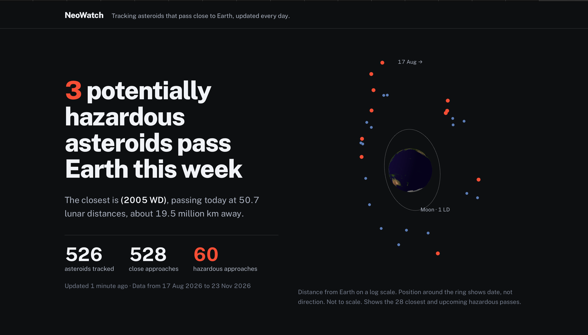
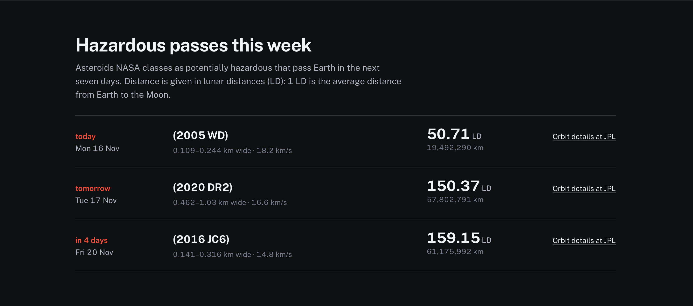
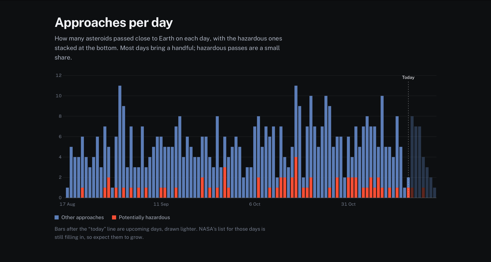
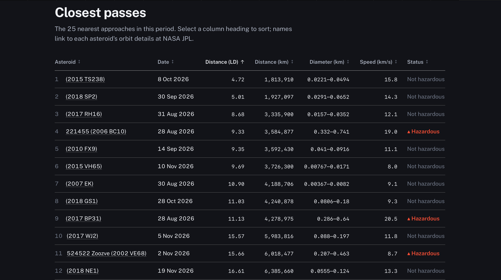

# NeoWatch

[](https://github.com/Eliasn20/NeoWatch/actions/workflows/ci.yml)

A .NET background service that tracks near-Earth asteroids from NASA's live data, stores every close approach idempotently in SQLite, and publishes a dashboard that rebuilds itself every day.

**Live dashboard: [eliasn20.github.io/NeoWatch](https://eliasn20.github.io/NeoWatch/)**



## What it does

NeoWatch pulls NASA's Near Earth Object Web Service (NeoWs) feed, backfills the last 90 days plus the coming week, and keeps it current on a schedule. Each run validates the raw data, upserts asteroids and their close approaches without creating duplicates, computes daily summaries, and logs alerts for potentially hazardous asteroids passing in the coming days. A GitHub Actions job runs the pipeline daily and publishes the results as a static dashboard: upcoming hazard alerts, approaches per day, distance versus size, the closest passes, and a 3D view of every pass around Earth.

## How it works

```
NASA NeoWs API
     │  7-day windows, typed HttpClient with retries and a circuit breaker
     ▼
Feed mapper ── parses and validates; bad rows are skipped, not fatal
     ▼
Idempotent upsert ── EF Core + SQLite, unique indexes as a backstop
     ▼
Daily summaries + hazard alerts
     ▼
JSON export ──► GitHub Actions (daily) ──► GitHub Pages dashboard
```

| Project | Role |
|---|---|
| `src/NeoWatch.Core` | Domain models, API DTOs, and pure pipeline logic. No dependencies, so it is easy to test. |
| `src/NeoWatch.Infrastructure` | NASA HTTP client, EF Core `DbContext`, repository, dashboard exporter. |
| `src/NeoWatch.Worker` | Host, dependency injection, timer loop, run-once mode, logging. |
| `tests/NeoWatch.Tests` | xUnit tests, including repository tests against a real in-memory SQLite engine. |
| `site/` | The dashboard: one static page that reads the exported `data.json`. |

## Design decisions

**A background worker that polls every 12 hours.** Close-approach data changes slowly, so polling every few minutes would waste API calls without adding information.

**SQLite with EF Core.** Zero setup, a single file, and real constraints and migrations. The repository tests run against the same engine in memory, so unique indexes and foreign keys behave exactly as in production.

**Resumable backfill on a fixed 7-day grid.** NeoWs accepts at most 7 days per request, so the date range is split into windows. The windows are aligned to a fixed grid, so a completed window matches across runs. Past windows are fetched once; windows touching today or the future are re-fetched, because NASA keeps adding to them. A second run costs 2 requests instead of 15.

**Idempotent upserts.** The worker sees the same asteroids again and again, so writes must be repeatable. Records are identified by what they are, never by measurements NASA revises: an asteroid by its NASA ID, a close approach by asteroid plus the exact moment of the pass. Existing rows are updated only when a value actually changed. Unique indexes on those keys guarantee no duplicates even if the application code had a bug: the application handles idempotency, the database enforces it.

**Validate, don't crash.** NeoWs sends distances and velocities as strings. They are parsed culture-invariantly (so a French-locale machine reads `"12.5"` correctly), and invalid rows are skipped instead of failing the batch. One failed window doesn't stop the others; every attempt is recorded in an `IngestionRuns` audit table and retried on the next run.

**Secrets stay out of the repo and out of the output.** The API key lives in .NET user-secrets locally and in a repository secret in CI. The exporter only reads database rows, so the key cannot reach the published JSON. Lesson learned along the way: saved API responses embed the key inside their links, so the test fixture was scrubbed before the first commit.

**A live dashboard without a server.** A daily GitHub Actions job runs the worker in run-once mode, exports a JSON snapshot, and deploys a static page to GitHub Pages. The job fails if no window succeeded, so a NASA outage can never publish an empty dashboard.

**Honest visualisation.** NeoWs gives each pass's distance but not its direction. In the 3D view, distance from Earth is real (on a log scale) and position around the ring encodes the date, and the caption says so, so nothing in the picture is invented.

## Screenshots







## How I built it

### Why

I've long been drawn to flight and space data: real measurements, arriving continuously, at scale. I wanted a project that treats that kind of data the way a production system would, not just as something to analyse: scheduled ingestion, failure handling, idempotent storage, secrets management, tests and CI, all the way to a live public result. I also built it to learn C# and .NET, coming from Java, by shipping something real instead of following tutorials.

### Design process

I designed the project through a structured design interview with Claude: it proposed options and challenged each choice, and I made the decisions: the data source, a background worker over a CLI or web API, SQLite with EF Core, the weekend scope, the 90-day backfill, the outputs, and later the live dashboard. I then built it in milestones, each ending with green tests and a commit.

### How I used AI

I used AI deliberately, in two roles:

- **As a tutor while learning C#.** Claude scaffolded the solution structure (projects, dependency injection, EF Core setup). I implemented the core pipeline logic step by step with it reviewing my code: date windowing, feed mapping and validation, the idempotent upsert including change detection, and the daily summaries.
- **As an engineering tool I direct.** For well-specified work, I used Claude Code: the edge-case test suite, run-once mode and the exporter, the dashboard, and the deployment workflow. I set the requirements, reviewed every diff, ran the tests, and verified the output before committing. I also pushed back on what it produced: I rejected the first dashboard as generic and had it redesigned, required the 3D view to represent the data honestly, and made CI fail on runs where every download failed.

The goal was to get the efficiency of AI tools without giving up the learning.

### What I learned

The hardest part was becoming productive in a new language and ecosystem quickly: async/await, dependency injection, EF Core's change tracking, nullable types, and patterns like `TryParse` with `out` parameters. What clicked was how much carries over: C#'s logic and syntax map closely onto Java, and LINQ maps almost one-to-one onto SQL (`GroupBy`, `Count`, `OrderBy`). Working with a real API taught me to distrust the data (numbers as strings, lists that fill in over time) and to treat secrets as something that can leak through places you don't expect.

### What's next

- A full web app with an API, so the data can be queried rather than only viewed.
- Notifications for upcoming close passes.
- Pulling orbital elements from the NeoWs lookup endpoint to explore modelling and trajectory visualisation.

## Tech stack

.NET 11 · C# · EF Core + SQLite · xUnit · Serilog · Microsoft.Extensions.Http.Resilience (Polly) · GitHub Actions · GitHub Pages · Chart.js · Three.js

## Run it locally

Requires the .NET 11 SDK and a free API key from [api.nasa.gov](https://api.nasa.gov).

```bash
# Store the key outside the repository
dotnet user-secrets set "NeoWs:ApiKey" "YOUR_KEY" --project src/NeoWatch.Worker

# Run the tests
dotnet test

# Run the worker (backfills, then repeats every 12 hours; Ctrl+C to stop)
dotnet run --project src/NeoWatch.Worker
```

To build the dashboard locally:

```bash
cd src/NeoWatch.Worker
NeoWs__RunOnce=true NeoWs__ExportPath=../../site/data.json dotnet run
cd ../..
python3 -m http.server 8000 -d site    # then open http://localhost:8000
```

## Limitations

- NeoWs provides miss distance but no approach direction, so the 3D view uses angle for date, not position.
- NASA's lists for upcoming days fill in over time, so recent future days show fewer approaches.
- The CI database is rebuilt on every run, so the published dashboard always covers a rolling 90-day window.
- "Potentially hazardous" is NASA's classification, not a prediction of impact.

## Credits

- Asteroid data: [NASA NeoWs](https://api.nasa.gov)
- Earth imagery:  NASA/Goddard Space Flight Center Scientific Visualization Studio
